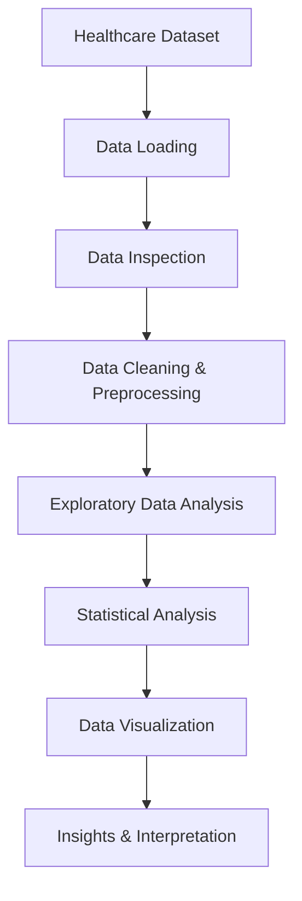

# 🏥 Healthcare Data Analysis | Python Project

<!-- Animated Header Banner -->
<p align="center">
  
</p>

<!-- Animated Typing Text -->
<p align="center">
  
</p>

<!-- Technology Badges -->
<p align="center">
  
  
  
  
  
</p>

---

## 📌 Project Overview

The **Healthcare Data Analysis Project** focuses on analyzing patient healthcare records using Python to identify meaningful patterns, explore health indicators, and generate valuable insights through Exploratory Data Analysis (EDA).

This project involves analyzing patient demographics, health conditions, diagnosis categories, and treatment information using Python libraries and statistical visualization techniques.

The main objective is to transform raw healthcare data into meaningful insights through data analysis and visualization.

---

## 🎯 Project Objectives

- Analyze patient demographic information.
- Perform data inspection and preprocessing.
- Explore patient health indicators.
- Analyze diagnosis and treatment categories.
- Understand BMI, cholesterol, heart rate, and blood pressure distributions.
- Identify patterns using statistical analysis.
- Create meaningful visualizations.
- Extract actionable insights from healthcare data.

---

## 📂 Dataset Information

The dataset contains **500 patient records and 10 attributes**.

| Column | Description |
|---|---|
| Patient_ID | Unique patient identifier |
| Age | Patient age |
| Gender | Patient gender |
| Blood_Pressure | Blood pressure measurement |
| Heart_Rate | Patient heart rate |
| Cholesterol_Level | Cholesterol measurement |
| BMI | Body Mass Index |
| Diagnosis | Patient diagnosis category |
| Treatment_Plan | Assigned treatment category |
| Follow_Up_Date | Follow-up appointment date |

---

## 🛠️ Tech Stack & Technologies

### 💻 Programming Language

<p>
  
</p>

<p>
  
</p>

### 📊 Data Analysis & Manipulation

<p>
  
  
</p>

**Libraries used:**
- Pandas – Data manipulation and analysis.
- NumPy – Numerical operations and calculations.

### 📈 Data Visualization

<p>
  
  
</p>

**Visualization techniques:**
- Histograms
- Bar Charts
- Box Plots
- Heatmaps
- Distribution Plots
- Comparative Visualizations

### 📓 Development Environment

<p>
  
</p>

---

## 🔍 Exploratory Data Analysis (EDA)

The project covers the following analytical activities:

### 1. 👥 Patient Demographics Analysis

- Age distribution.
- Gender-wise patient distribution.
- Patient demographic patterns.

### 2. ❤️ Health Indicators Analysis

- Blood pressure distribution.
- Heart rate distribution.
- Cholesterol level distribution.
- BMI distribution.

### 3. 🏥 Diagnosis & Treatment Analysis

- Diagnosis category analysis.
- Treatment plan distribution.
- Diagnosis-wise comparisons.
- Patient health category exploration.

### 4. 📊 Statistical Analysis

- Descriptive statistics.
- Mean, median, and standard deviation.
- GroupBy operations.
- Aggregation and pivot tables.
- Comparative analysis.
- Correlation analysis where applicable.

---

## 📸 Data Visualization

The following visualizations help understand different patient health indicators.

### Age Distribution

<p align="center">
  
</p>

### BMI Distribution

<p align="center">
  
</p>

### Cholesterol Level Distribution

<p align="center">
  
</p>

### Heart Rate Distribution

<p align="center">
  
</p>

### Blood Pressure Distribution

<p align="center">
  
</p>

---

## ⚙️ Project Workflow



---

## 📁 Repository Structure

```text
Python--Healthcare-Project/
│
├── Project -03 Health Care Dataset.ipynb
│
├── BMI Distribution.png
├── Cholesterol Level Distribution.png
├── Heart Rate Distribution.png
├── age distribution.png
├── blood pressure distribution.png
│
└── README.md
```

---

## 🚀 How to Run This Project

### Step 1: Clone the Repository

```bash
git clone https://github.com/komalrofficial/Python--Healthcare-Project.git
```

### Step 2: Navigate to the Project

```bash
cd Python--Healthcare-Project
```

### Step 3: Install Required Libraries

```bash
pip install pandas numpy matplotlib seaborn jupyter
```

### Step 4: Launch Jupyter Notebook

```bash
jupyter notebook
```

### Step 5: Execute the Notebook

Open:

`Project -03 Health Care Dataset.ipynb`

Run the cells sequentially. Ensure the healthcare dataset file is available and its path is correctly configured.

---

## 💡 Key Learnings

Through this project, I gained practical experience in:

- Python programming for data analysis.
- Data manipulation using Pandas.
- Numerical operations using NumPy.
- Exploratory Data Analysis.
- Data cleaning and preprocessing concepts.
- Statistical analysis and aggregation.
- Data visualization using Matplotlib and Seaborn.
- Extracting meaningful insights from healthcare datasets.

---

## 🔮 Future Enhancements

- Develop an interactive healthcare dashboard using Power BI.
- Integrate SQL for healthcare database analysis.
- Explore predictive analytics using Machine Learning.
- Implement automated data processing workflows.
- Build advanced healthcare data visualizations.

---

## 👩‍💻 About the Author

**Komal Rangari**

Aspiring Data Engineer | Power BI Developer | Python & SQL Enthusiast

<p align="left">
  <a href="https://github.com/komalrofficial">
    
  </a>
  <a href="https://www.linkedin.com/in/YOUR_LINKEDIN_USERNAME/">
    
  </a>
</p>

---

<p align="center">
  <b>🏥 Transforming Healthcare Data into Meaningful Insights with Python 🚀</b>
</p>

<p align="center">
  
</p>

<p align="center">
  ⭐ If you find this project interesting, consider giving it a star!
</p>
